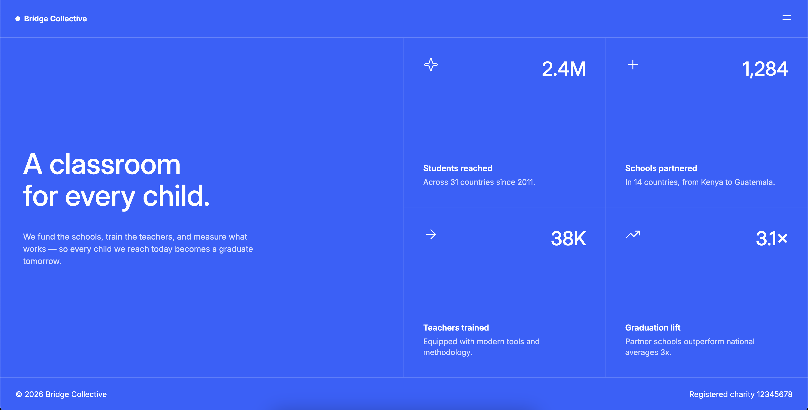

# Bridge Collective — HTML/CSS Practice

A responsive landing page built in pure HTML and CSS, based on a Frontend Mentor challenge. The whole layout relies on CSS Grid: a two-column hero, with a 2×2 grid of stat cards on the right.

**[Live Demo →](https://aleksrdesign.github.io/bridge-collective/)**



## Overview

This project is a front-end practice exercise focused on structuring a full page with CSS Grid, then adapting it from desktop to mobile. No frameworks, no CSS libraries. The layout collapses step by step through three breakpoints: the hero text shrinks, the two columns stack, then the stat cards stack too.

## Tech Stack

- HTML5
- CSS3 (Grid, Flexbox, custom properties, media queries)
- Google Fonts (Inter)

## Project Structure

```
├── index.html
├── style.css
├── images/
└── screenshots/
    └── preview.png
```

## Concepts Practiced

- CSS Grid for the page layout (two-column hero, 2×2 stats grid)
- Flexbox for the header, the footer and the content inside each card
- Responsive design with media queries (1024px, 768px, 600px)
- Custom properties for colors and font
- Borders handled with `:nth-child` to draw the grid lines between cards
- `:hover` and transitions
- Semantic HTML (`header`, `main`, `article`, `footer`)

## Planned Improvements

A V2 is planned once I've learned JavaScript. The menu button is only a visual placeholder for now: the next step is to make it open a working mobile menu.

## Credits

Challenge by [Frontend Mentor](https://www.frontendmentor.io). The design and assets come from the challenge.
