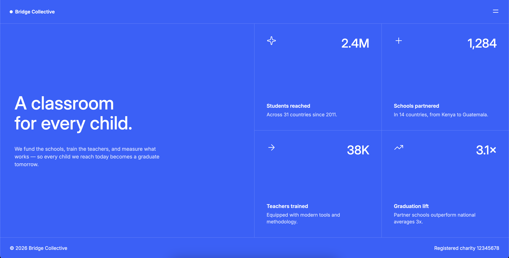

# Bridge Collective — HTML/CSS/JS Practice

A responsive landing page built in HTML, CSS and a little JavaScript, based on a Frontend Mentor challenge. The whole layout relies on CSS Grid: a two-column hero, with a 2×2 grid of stat cards on the right. V2 adds a working navigation menu.

**[Live Demo →](https://aleksrdesign.github.io/bridge-collective/)**



## Overview

This project is a front-end practice exercise focused on structuring a full page with CSS Grid, then adapting it from desktop to mobile. No frameworks, no CSS libraries. The layout collapses step by step through three breakpoints: the hero text shrinks, the two columns stack, then the stat cards stack too.

## What's new in V2

- A working menu: the button opens a side panel on desktop and a full-width panel on mobile
- A dark overlay behind the panel
- The button switches between a burger and a close icon
- `aria-expanded` is kept in sync for screen readers
- All `px` values converted to `rem`, so the layout follows the browser's font size

The JavaScript only toggles a `menu-open` class on `body`. CSS handles everything that changes on screen.

## Tech Stack

- HTML5
- CSS3 (Grid, Flexbox, custom properties, media queries, rem units)
- JavaScript (vanilla)
- Google Fonts (Inter)

## Project Structure

```
├── index.html
├── style.css
├── script.js
├── images/
└── screenshots/
    └── preview.png
```

## Concepts Practiced

- CSS Grid for the page layout (two-column hero, 2×2 stats grid)
- Flexbox for the header, the footer and the content inside each card
- Responsive design with media queries (1024px, 768px, 600px)
- Custom properties for colors and font
- Borders handled with `:nth-child` to draw the grid lines between cards
- `:hover` and transitions
- Semantic HTML (`header`, `main`, `article`, `footer`)
- `rem` units instead of `px` for sizes and spacing
- `querySelector`, `addEventListener` and `classList.toggle`
- Basic accessibility with `aria-expanded` and `aria-controls`
- Git branches and tags to release a V2

## Planned Improvements

- Close the menu when clicking the overlay
- Close the menu with the Escape key
- Lock the page scroll while the menu is open
- Add a transition when the menu opens

## Credits

Challenge by [Frontend Mentor](https://www.frontendmentor.io). The design and assets come from the challenge.
